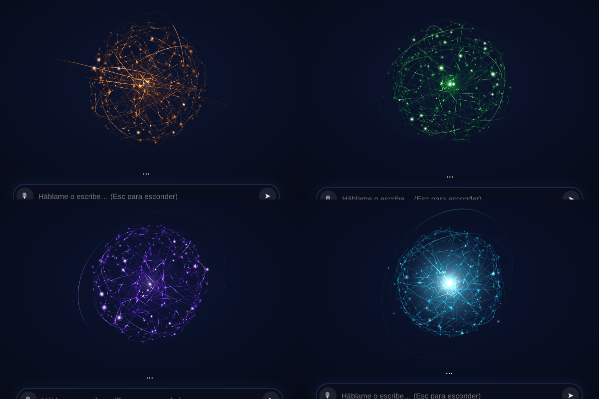
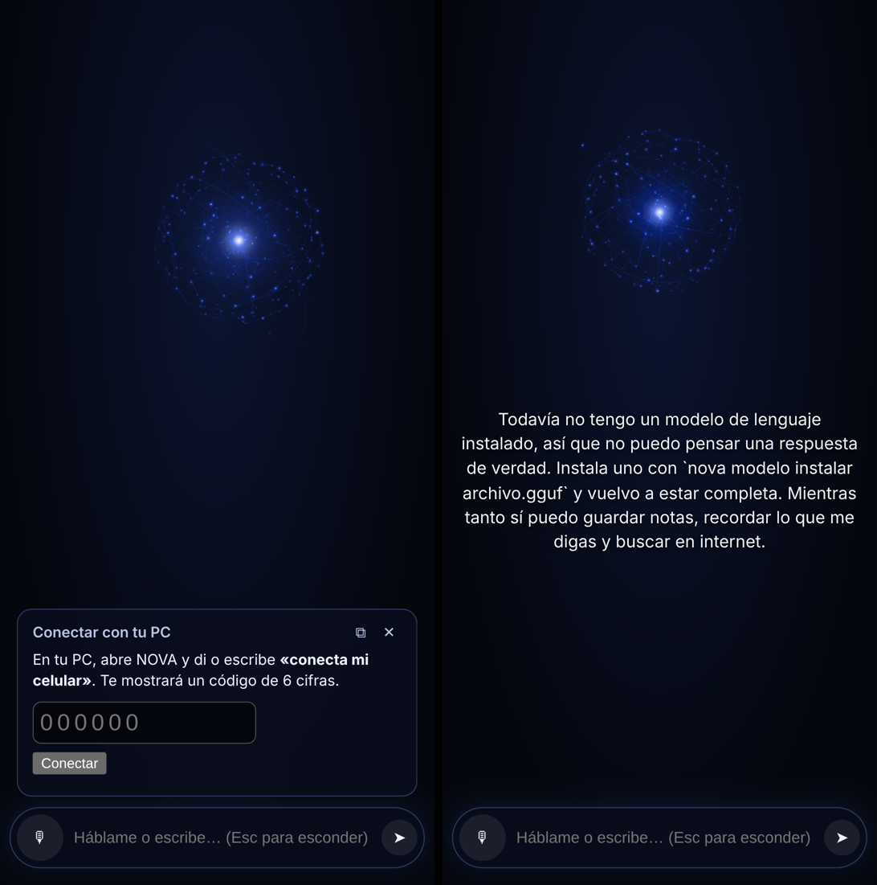

# NOVA

NOVA es una asistente de inteligencia artificial que vive en tu computadora. Es un proyecto propio e independiente: tiene su motor, su memoria, su voz, su personalidad y su avatar, un orbe holográfico que flota libre por tu escritorio. Funciona sin internet y, cuando hay conexión y no sabe algo, lo busca en seguida.

> **Estado: versión 1.4.0.** Instalada en la PC de Aroon (Windows 11, RTX 3050). Se actualiza desde este repositorio con `actualizar.bat`. Cada cambio corre 263 pruebas en Linux y en Windows (GitHub Actions), y GitHub compila el orbe de escritorio. Falta probar en la PC de Aroon lo que depende de su equipo: ver [Pendiente de verificar](#pendiente-de-verificar).



## Qué hace

| | |
|---|---|
| **Motor propio** | Lanza `llama-server` (llama.cpp) dentro de la app, solo en `127.0.0.1`, lo carga al abrir NOVA y lo deja cargado mientras está abierta. Mide la memoria de video libre y acomoda el contexto y las capas para no desbordarse a la memoria compartida (eso lo vuelve lentísimo). Recorta lo que manda para que siempre quepa. Cada respuesta deja su tiempo en `estado\tiempos.log`. En Windows vive en un Job Object: si NOVA se cierra, el motor muere con ella. |
| **Personalidad** | Cálida, mexicana, directa y honesta de que es una IA. Editable en `personalidad.md`. |
| **Conciencia de sí misma** | En cada respuesta sabe qué versión es, qué modelo usa, si hay internet, qué voz tiene y qué recuerda. Recuerda cuándo «nació». |
| **Memoria de ti** | Quién eres, cómo hablas, gustos, proyectos, momentos y preferencias. Aprende por reglas al instante («me llamo…», «recuerda que…») y con el modelo cada 10 mensajes. «¿Qué sabes de mí?», «olvida lo de…», «esto no lo recuerdes» (modo privado). Nunca guarda contraseñas, claves, tarjetas ni códigos. |
| **Conversación junto al orbe** | Lo que se dicen aparece al lado del orbe, sin recuadros; lo viejo se desvanece y vuelves a ello con la barra. Al reabrir, la conversación sigue y NOVA la tiene en cuenta. |
| **Ve tu pantalla** | «Mira mi pantalla» o «¿qué ves?»: captura la pantalla (escondiendo su ventana un instante) y la mira con el modelo con vista (Qwen3-VL 4B) o lee su texto con el OCR de Windows. Siempre sabe en qué ventana estás trabajando. |
| **Conoce tus archivos** | Lee Documentos y Escritorio, más las carpetas que le pidas («conoce la carpeta N:\\…»): texto, código y Word. Usa lo relevante como contexto y encuentra archivos por nombre. |
| **Aprende de internet** | Si responde «no sé» y hay conexión, busca y vuelve a responder citando fuentes. Lo que aprende queda guardado para usarlo sin conexión. |
| **Herramientas** | Buscar y leer en la web, buscar en su memoria y en tus documentos indexados, leer y listar archivos de todas tus unidades, proponer escribir archivos, órdenes (git, dotnet…), calculadora, notas, tareas y discos. |
| **Skills** | Carpetas con un `SKILL.md` (formato Agent Skills) que le enseñan a hacer algo a tu manera. Trae cuatro: `crear-skill`, `revisar-codigo`, `mensaje-commit` y `explicar-error`. Pon las tuyas en `skills\` o en `%APPDATA%\NOVA\skills`; también lee `~/.claude/skills`. «Baja las skills de anthropic» trae las de github.com/anthropics/skills (menos docx, pdf, pptx y xlsx, por su licencia). «¿Qué skills tienes?», «usa la skill …». Ver [skills/LEEME.md](skills/LEEME.md). |
| **Seguridad** | Nunca corre como administrador. Nada de formatear, particionar, arranque, BitLocker, registro ni borrado masivo. Lo que cambia algo se confirma con un código de 4 cifras que solo aparece en pantalla. Páginas, archivos y pantalla son datos, nunca órdenes. |
| **Voz** | Pulsar para hablar (Ctrl+Alt+Espacio): whisper.cpp para oír y Piper con voz es_MX para hablar, todo local. El orbe late con su voz. |
| **Plática de a ratos** | Hasta 3 veces al día te habla por iniciativa (retoma tus proyectos, pregunta cómo te fue, sugiere un descanso). Nunca con pantalla completa, en llamada, con «No molestar» ni de 23:00 a 08:00. |
| **Orbe** | Red de nodos y conexiones con anillos orbitales. Reposo (azul tenue), activa (azul brillante), procesando (dorado), buscando (verde), hablando (púrpura). Colores por contexto: azul general, cian tecnología, púrpura creatividad, dorado análisis, verde investigación, rojo prioridad, rosa apoyo. Se mueve libre por el escritorio y se aparta del cursor. |
| **Cerebro grande** | Opcional: un modelo grande en la nube (Groq gratis, ver `oracle/CEREBRO-GRATIS.md`) para entender mejor. Con `cerebro_auto` lo usa siempre que hay internet; si falla o no hay red, contesta con el modelo local. |
| **Tus archivos primero** | Si le preguntas por tus archivos, carpetas o proyectos, usa sus herramientas locales (y revisa la ruta que escribas) en vez de buscar en internet. |
| **Libre en el escritorio** | El acceso «NOVA» abre el orbe flotando sobre tus ventanas, sin marco y dejando pasar los clics; «NOVA en ventana» la abre en su ventana. Para escribirle: clic en el orbe, Alt Gr+A (Ctrl+Alt+A) o clic en su icono junto al reloj. Alt Gr+Q (o Ctrl+Shift+Q) la esconde y la vuelve a sacar. Se queda quieta mientras piensa o habla, y el texto va sobre un vidrio oscuro para leerse con cualquier fondo. |
| **Celular** | Conexión directa celular ↔ PC por el Wi-Fi de tu casa, sin nube. Emparejas con un código de 6 cifras. |

## Estructura

```
nova/                 núcleo en Python (sin dependencias obligatorias)
  nucleo.py           el cerebro: une todo y piensa en pasos (ACCION/FINAL)
  motor.py            llama-server administrado (+ motor simulado sin modelo)
  memoria.py          SQLite: recuerdos, conocimiento, conversaciones, notas, tareas, documentos
  aprendizaje.py      cómo aprende de ti
  personalidad.py     identidad, estado propio, colores por contexto
  herramientas.py     lo que puede usar mientras piensa
  skills.py           skills (carpetas con SKILL.md): catálogo, elegir y leer
  politica.py         política de órdenes y rutas (falla cerrada)
  internet.py         buscar y leer, sin redes internas
  voz.py              whisper.cpp, Piper y órdenes rápidas
  platica.py          iniciativa con límites
  celular.py          emparejamiento y HTTPS propio para el celular
  servidor.py         API local para el orbe (y para el celular)
  cli.py              la orden `nova`
skills/               skills incluidas (y las tuyas, si quieres)
ui/                   el orbe (Three.js, sin internet) y la interfaz
desktop/src-tauri/    envoltorio de escritorio: ventana transparente, bandeja, atajos
tests/                pruebas automáticas
```

## Instalar en Windows

Doble clic en **`instalar.bat`** (sin «Ejecutar como administrador»). Instala Python si falta, crea el entorno de NOVA, detecta tu tarjeta y baja llama.cpp con CUDA 12 (o Vulkan), el modelo Qwen3 4B Instruct (Q4_K_M, verificado con SHA256), whisper.cpp con el modelo small y Piper con voz es_MX. Crea el acceso **NOVA** en el menú Inicio (Ctrl+Alt+N), revisa el equipo con `nova diagnostico` y abre NOVA. Todo queda en `%LOCALAPPDATA%\NOVA`.

La guía de la primera prueba, paso a paso, está en [PRUEBA-WINDOWS.md](PRUEBA-WINDOWS.md).

<details><summary>Instalación a mano</summary>

1. Python 3.12 de python.org y `pip install -e .[completo]` en esta carpeta.
2. llama.cpp para Windows (`llama-<versión>-bin-win-cuda-12.4-x64.zip` más `cudart-llama-bin-win-cuda-12.4-x64.zip`, o la de Vulkan) en `%LOCALAPPDATA%\NOVA\llama\`.
3. Un modelo GGUF de 3–4B en Q4_K_M: `nova modelo instalar C:\ruta\modelo.gguf`.
4. Opcional: `whisper-cli.exe` y `ggml-small.bin` en `%LOCALAPPDATA%\NOVA\whisper\`; `piper.exe` y `es_MX-claude-high.onnx` (+ `.onnx.json`) en `%LOCALAPPDATA%\NOVA\piper\`.

</details>

## Usar

- **Ventana de NOVA:** el acceso **NOVA** del menú Inicio (Ctrl+Alt+N) o `iniciar-nova.bat`. Abre el orbe en su propia ventana (Edge en modo app). Si NOVA ya está abierta, solo trae la ventana.
- **Escritorio (orbe libre sobre todas las ventanas):** necesitas Rust y la CLI de Tauri (`cargo install tauri-cli --version "^2"`). Luego en `desktop\src-tauri`:
  ```
  cargo tauri dev        (para probar)
  cargo tauri build      (instalador .exe por usuario)
  ```
  El envoltorio arranca el núcleo solo y lo cierra al salir. **Ctrl+Alt+A** abre la barra para escribir, **Esc** la esconde, mantén **Ctrl+Alt+Espacio** para hablar.
- **Terminal:** `nova chat`, `nova preguntar "…"`, `nova yo`, `nova tareas`, `nova memoria indexar D:\Proyectos`, `nova web buscar "…"`, `nova orden "git status"`, `nova skills`.

### Celular

1. Con NOVA abierta en la PC, dile **«conecta mi celular»**. Te da una dirección (por ejemplo `https://192.168.1.20:8191/`) y un código de 6 cifras que vale 5 minutos.
2. En el celular, conectado al mismo Wi-Fi, abre esa dirección. La primera vez el navegador dirá que el certificado no es de confianza: es el certificado propio de NOVA, acéptalo.
3. Escribe el código. Listo: el celular queda emparejado y puedes agregarlo a la pantalla de inicio como app.

Windows te preguntará si permites a Python en redes privadas: acepta solo **redes privadas**. «Desconecta mis celulares» revoca todos. Desde el celular puedes chatear, hablarle y confirmar acciones normales; lo que exige clic en la PC (escribir fuera de tu carpeta o en otra unidad) solo se confirma en la PC. Fuera de tu casa no funciona todavía (ver hoja de ruta).



Para que el servidor del celular arranque siempre, pon `"celular": true` en `%APPDATA%\NOVA\config.json`.

## Configuración

`%APPDATA%\NOVA\config.json` (solo las claves que quieras cambiar). Las principales: `internet`, `internet_searxng_url`, `unidades_excluidas`, `platica`, `platica_max_dia`, `silencio_desde`, `silencio_hasta`, `voz_responder_hablando`, `celular`, `gpu_layers`, `context`. Todas están en `nova/config.py`.

## Pruebas

```
pip install pytest
python -m pytest
```

## Pendiente de verificar

Lo que no se ha podido comprobar todavía, en orden de importancia:

1. **Con un modelo real**: que un modelo de 3–4B siga bien el formato `ACCION:/FINAL:` y la velocidad en la RTX 3050.
1. **La vista (0.2)**: que Qwen3-VL 4B con su proyector quepa en 4 GB (el proyector va en el procesador) y que siga las herramientas tan bien como el modelo de texto. Si no, `"vision": false` en `config.json` vuelve al modelo de texto y NOVA usa el OCR de Windows.
1. **Captura y OCR**: ya funcionan en Windows (lo confirman las pruebas en GitHub); falta verlos con tu pantalla real.
2. **El orbe de escritorio en tu PC**: GitHub lo compila en Windows, pero la transparencia, el paso de clics, la barra y los atajos solo se ven en tu pantalla. Si algo falla, queda anotado en `%LOCALAPPDATA%\NOVA\estado\escritorio.log`.
3. **Búsqueda en DuckDuckGo**: el lector de resultados está probado con HTML de ejemplo; si DuckDuckGo bloquea las consultas, usa una instancia de SearXNG (`internet_searxng_url`).
4. **Voz**: los argumentos de `whisper-cli` y `piper` según las versiones que instales.
5. **Celular**: que la red de tu casa permita la conexión y que el micrófono del celular funcione con el certificado propio.

## Hoja de ruta

- **0.2 Siempre atenta:** palabra de activación «Oye, NOVA» (openWakeWord), ver la pantalla con OCR de Windows, vigilantes de proyectos, instalador con todo incluido.
- **0.3 Aprende más:** búsqueda por significado (embeddings locales), consolidación nocturna más inteligente, redactar como tú.
- **0.4 Desarrolladora:** integración con VS Code, crear y probar proyectos completos, crear documentos e imágenes.
- **Celular fuera de casa:** conexión cifrada punto a punto (por ejemplo con Tailscale) sin pasar por servidores de NOVA.
